# Отчёт: 10 задач по BIOS/UEFI в Lenovo BIOS Simulator Center

**Выполнил:** Коковашин Тимур Александрович, группа 11/1-РПО-26/1
**Дата:** 16.11.2026
**Симулятор:** https://download.lenovo.com/bsco/index.html (Simulator V4.3.0)
**Устройство:** ThinkPad T14s Gen 5 (21LS, 21LT), Graphics Interface Mode
**Дополнительно (задача 7):** ThinkPad P53 (20QN, 20QQ) — в T14s Gen 5 нет раздела Storage

---

## Подготовка: выбор устройства

Launch Simulator → поиск «T14s Gen 5» → ThinkPad T14s Gen 5 (21LS,21LT) → Graphics Interface Mode.

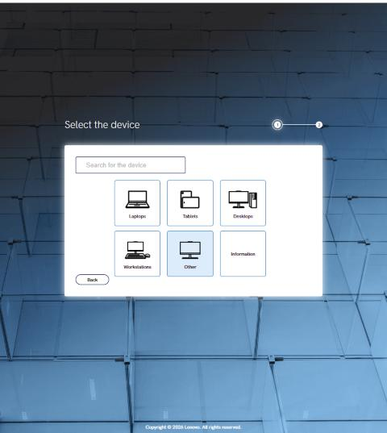
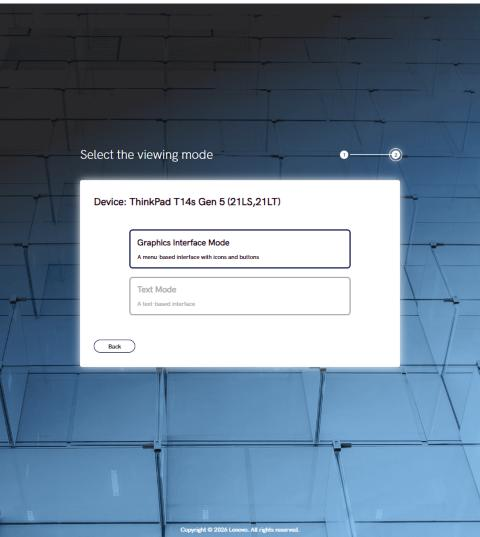

---

## Задача 1. Навигация по основным разделам

Меню слева: **Main, Config, Date/Time, Security, Startup, Restart**.

**Main** — только информация:

| Параметр | Значение |
|---|---|
| UEFI BIOS Version | N46ET09W |
| UEFI BIOS Date | 2024-01-22 |
| Embedded Controller Version | N46HT10W |
| Machine Type Module | 21LS |
| System-unit serial number | PF12345 |
| System board serial number | L112345678 |
| CPU Type | Intel(R) Core(TM) CPU |
| CPU Speed | 1.X00GHz |
| Installed memory | 8192MB |
| UEFI Secure Boot | On |
| BIOS Event log | (Simulator not support) |

**Config** — Network, USB, Keyboard/Mouse, Display, Power, Beep and Alarm, CPU, Thunderbolt(TM) 4, Intel(R) AMT, Intel(R) Standard Manageability.
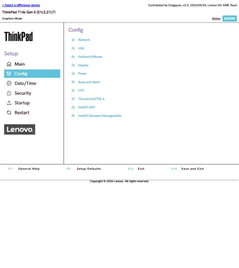

**Security** — Password, Fingerprint, Security Chip, UEFI BIOS Update Option, Memory Protection, Virtualization, I/O Port Access, Internal Device Access, Secure Boot, Reset system to Factory Defaults и др.
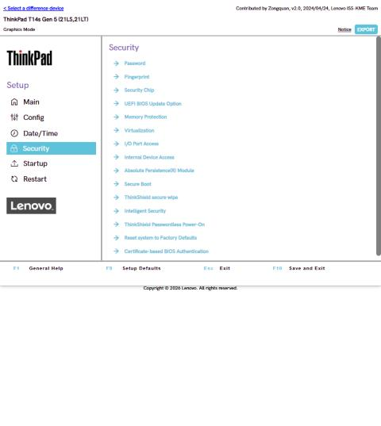

**Startup** — Boot, Network Boot, Boot Mode, Option key Display, Boot device List F12 Option, Boot Order Lock.

**Restart** — Exit Saving Changes, Exit Discarding Changes, Save Custom Defaults, Load Custom Defaults, Load Factory Defaults, Discard Changes, Save Changes.
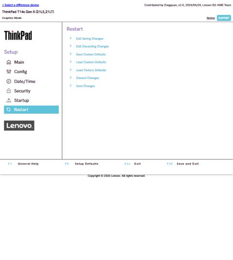

**Где находятся настройки из задач 2–5:**
- Порядок загрузки → **Startup → Boot**
- Secure Boot → **Security → Secure Boot**
- Пароль супервизора → **Security → Password → Supervisor Password**
- Сброс → **Restart → Load Factory Defaults** (или F9)

---

## Задача 2. Смена порядка загрузки

**Путь:** `Startup → Boot → Boot Priority Order`

Исходный порядок: Windows Boot Manager, USB CD, USB FDD, NVMe0, USB HDD, PXE BOOT, LENOVO CLOUD, ON-PREMISE.

Перетаскиванием (drag & drop) поставил **USB HDD** на 1-е место:

**NVMe0** — на 2-е место:
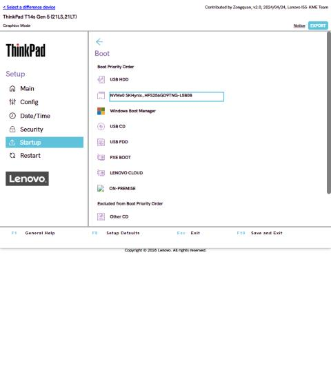

**F10 (Save and Exit)** → «Save configuration changes and exit now?» → Yes:
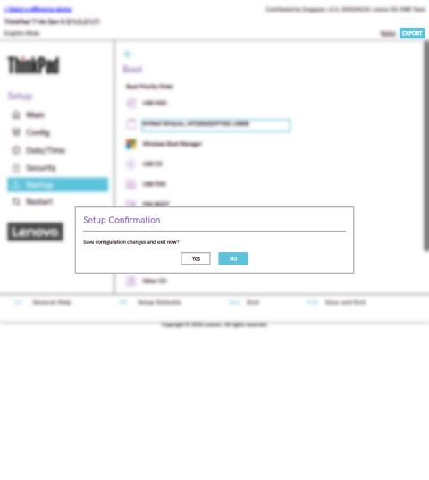

После сохранения порядок остался: USB HDD → NVMe0 → Windows Boot Manager → …

**Итог:** клавиша сохранения — **F10**; порядок отображается в Startup → Boot.

---

## Задача 3. Включение/выключение Secure Boot

**Путь:** `Security → Secure Boot → Secure Boot`

Исходный статус — **On** (Secure Boot Mode: User Mode, Key State: Standard Mode).

Переключил в **Off**:
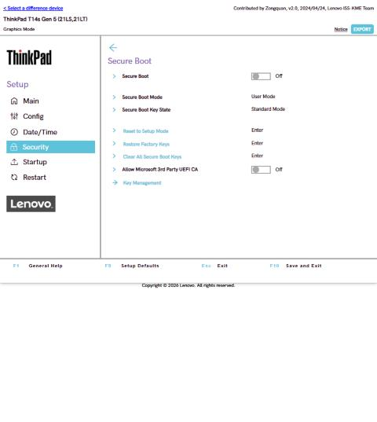

Вернул в **On**:
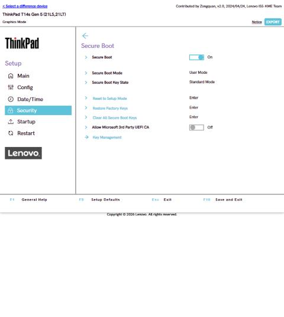

**Перезагрузка:** сам переключатель меняется сразу, без диалога. Чтобы изменение применилось, нужно сохранить настройки (F10) и перезагрузить ПК.

**Зачем нужен Secure Boot:** при загрузке UEFI проверяет цифровые подписи загрузчика и драйверов по базе доверенных ключей (db/dbx). Неподписанный или изменённый загрузчик (буткит, руткит) не запустится. Отключать его иногда приходится для загрузки неподписанных ОС и утилит.

---

## Задача 4. Установка пароля супервизора

**Путь:** `Security → Password → Supervisor Password`

Исходно — Disabled.

Открыл окно Supervisor Password:
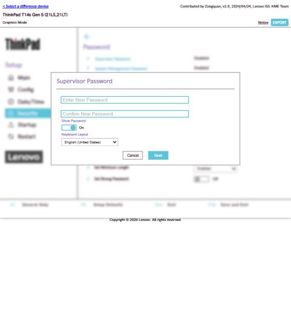

Ввёл `Test1234` в оба поля (включён Show Password):
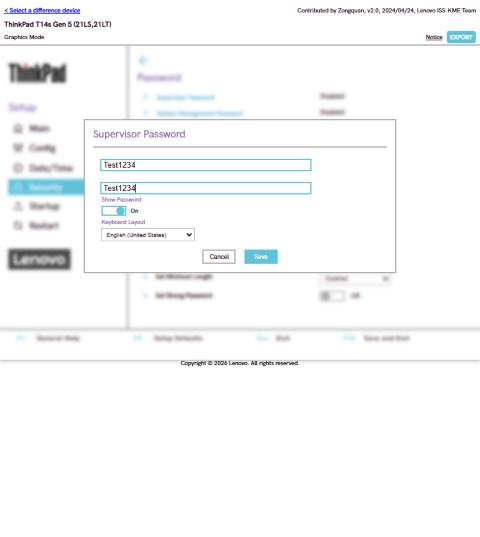

После Save статус — **Enabled**:

**Проверка:** при изменении настройки (Lock UEFI BIOS Settings) симулятор пароль **не запросил**. На реальном ThinkPad пароль супервизора запрашивается при входе в Setup (F1); без него настройки только просматриваются.

**Снятие пароля:** на реальном ПК вводят текущий пароль, а поля нового оставляют пустыми. Симулятор пустой пароль не принимает («Password must has at least 1 character»):
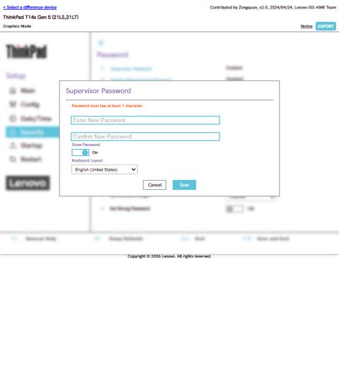

После отмены пароль остался Enabled:

Поэтому пароль сняли через Load Factory Defaults (задача 5). **Важно:** на реальном ThinkPad Load Factory Defaults пароль супервизора **не** сбрасывает — это особенность симулятора.

---

## Задача 5. Сброс на заводские настройки

**Путь:** `Restart → Load Factory Defaults` (или **F9 — Setup Defaults**)

«Load the BIOS factory default configuration now?» → Yes:
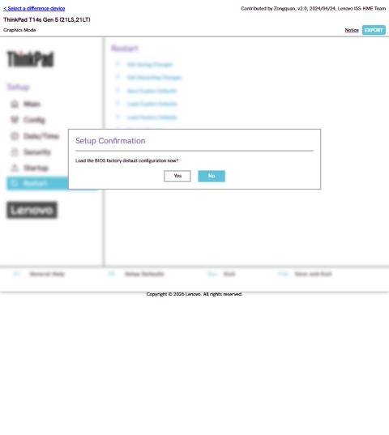

После сброса:

Порядок загрузки вернулся к исходному (Windows Boot Manager первым):

Supervisor Password снова **Disabled**; Secure Boot — On (по умолчанию):

**Итог:** настройки задач 2–4 сброшены; сброс — **Restart → Load Factory Defaults** или **F9**, затем **F10** для сохранения.

---

## Задача 6. Управление встроенными устройствами (USB)

**Путь 1:** `Config → USB → Always On USB`

В T14s Gen 5 нет пункта «USB BIOS Support», есть **Always On USB** (питание USB при выключенном/спящем ПК) с подпунктом Charge in Battery Mode.

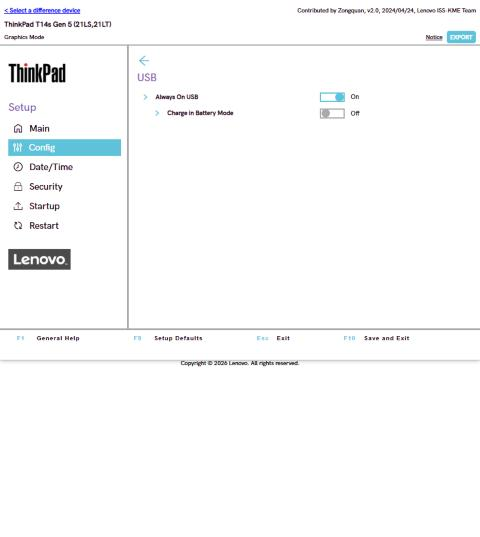
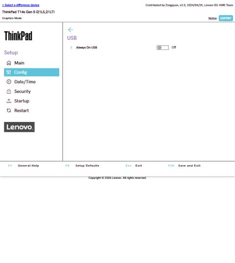

**Путь 2 (полное отключение портов):** `Security → I/O Port Access → USB Port`

Здесь же отключаются Wireless LAN/WAN, Bluetooth, камера, аудио, микрофон, сканер отпечатков, Thunderbolt 4, NFC.

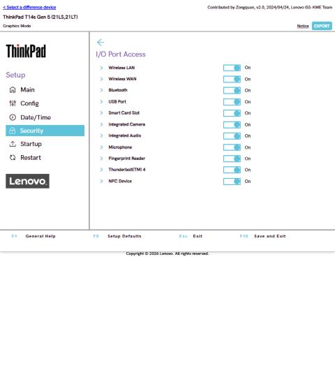

**Итог:** USB-порты отключаются в **Security → I/O Port Access → USB Port**; питание USB в выключенном состоянии — **Config → USB → Always On USB**.

---

## Задача 7. Режим работы SATA/NVMe

В T14s Gen 5 (и T14 Gen 2, P15 Gen 2) раздела Config → Storage нет — там контроллер работает в фиксированном режиме.
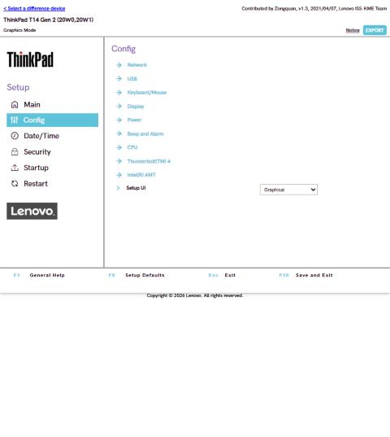

Поэтому задачу выполнил на **ThinkPad P53**, где Storage есть.
**Путь:** `Config → Storage → Controller Mode`
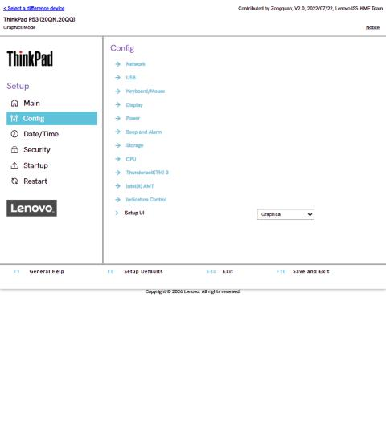
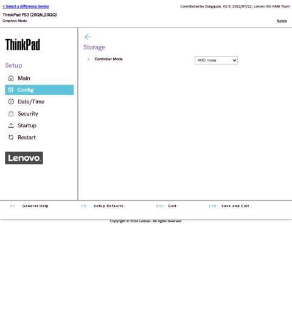

Варианты: **AHCI mode** и **RST mode** (Intel Rapid Storage Technology, нужен для RAID и Optane):
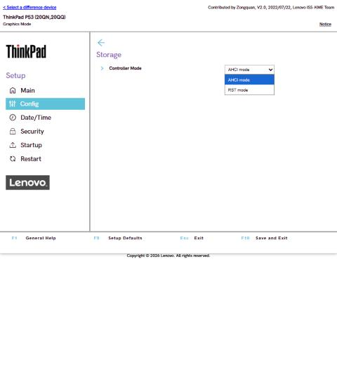

При смене режима появилось предупреждение: «The existing data stored on the drives may be damaged when changing Controller Mode. Do you want to proceed?»
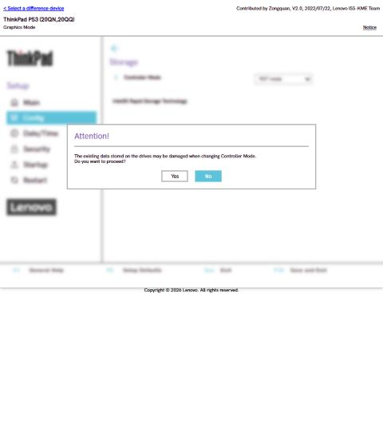

После переключения на RST появился пункт Intel(R) Rapid Storage Technology:
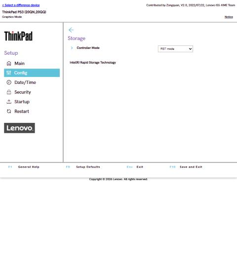

Вернул **AHCI mode**:

**Риски смены режима:** установленная Windows может не загрузиться (синий экран INACCESSIBLE_BOOT_DEVICE), потому что нужного драйвера нет в загрузке. Ещё возможна потеря RAID-массива и данных. Менять режим нужно до установки ОС или заранее подготовить драйверы (например, загрузка в безопасном режиме).

---

## Задача 8. Временное меню загрузки (F12)

**Путь:** `Startup`
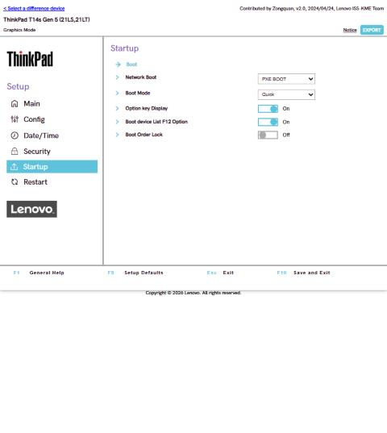

- **Boot device List F12 Option = On** — разрешает F12 при включении ПК. Появляется разовое меню выбора устройства; порядок в Startup → Boot при этом не меняется. По справке опцию можно менять только тогда, когда в Setup вошли с паролем супервизора, поэтому без пароля переключатель не реагировал.
- **Boot Mode:** Quick (диагностический экран скрыт) / Diagnostics (показывает POST-сообщения). Переключил на Diagnostics и вернул Quick:

**Разница:** Startup → Boot — **постоянный** порядок, сохраняется в UEFI и действует при каждом включении. F12 — **разовый** выбор устройства только для текущей загрузки (например, один раз загрузиться с флешки).

---

## Задача 9. Просмотр системных логов

**Путь:** `Main → BIOS Event log`

В симуляторе пункт есть, но не работает: «(Simulator not support)». Раздела Config → Diagnostics у этой модели нет, поэтому Clear Event Log выполнить нельзя.

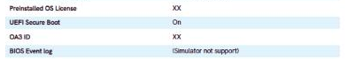

**На реальном ThinkPad:** `Main → BIOS Event Log` — журнал событий POST, ошибок и изменений настроек. Очищается там же через **Clear BIOS Event Log**. Также помогают Boot Mode = Diagnostics (POST-сообщения на экране) и встроенная диагностика Lenovo (F10 при включении).

---

## Задача 10. Полный сценарий: подготовка к переустановке ОС

**1. Factory Defaults** — Restart → Load Factory Defaults → Yes:

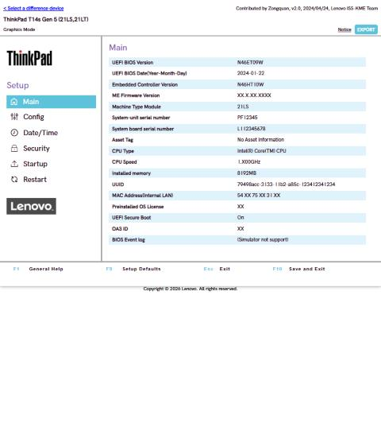

**2. Secure Boot** — Security → Secure Boot: после сброса уже **On**:
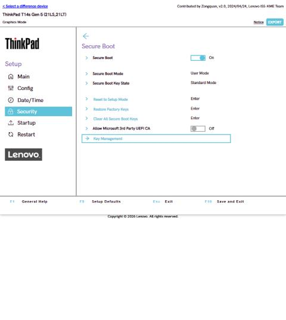

**3. Supervisor Password** — Security → Password → Supervisor Password → `Test1234` → Save:

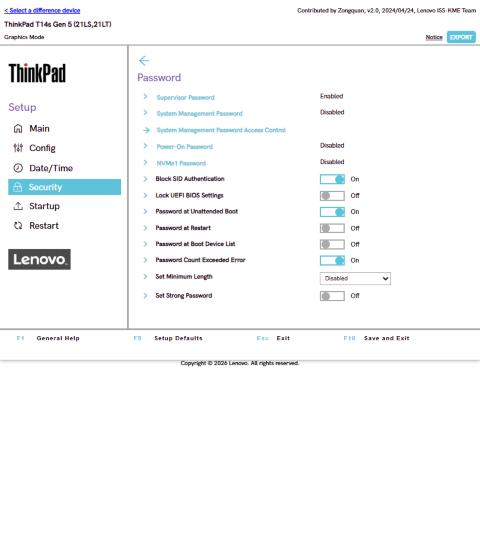

**4. USB первым** — Startup → Boot, USB HDD перетащен на 1-е место:

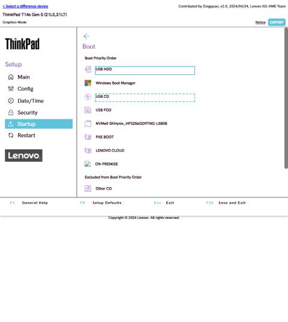

**5. F10 — Save and Exit** → Yes:
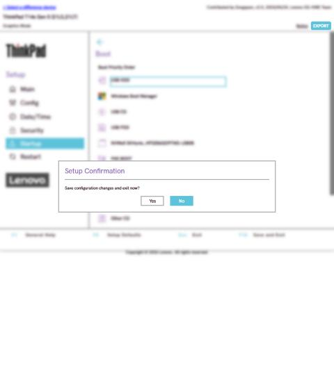

**6. Повторный вход и проверка:**
- порядок загрузки сохранён (USB HDD первым):
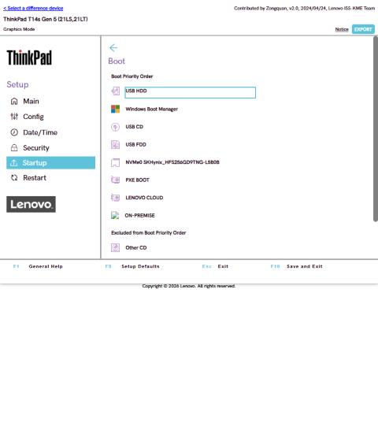
- пароль сохранён (Enabled):

- вернул исходный порядок (USB HDD снова после NVMe0):
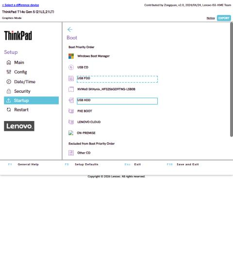
- снял пароль (в симуляторе — через Load Factory Defaults), статус Disabled:

**Итог:** все 6 шагов выполнены, настройки проверены после повторного входа.

---

## Шпаргалка: точные пути (ThinkPad T14s Gen 5)

| Настройка | Путь |
|---|---|
| Информация о системе | Main |
| Порядок загрузки | Startup → Boot → Boot Priority Order |
| Secure Boot | Security → Secure Boot → Secure Boot |
| Пароль супервизора | Security → Password → Supervisor Password |
| Сброс | Restart → Load Factory Defaults / F9 |
| Сохранить и выйти | F10 / Restart → Exit Saving Changes |
| Питание USB | Config → USB → Always On USB |
| Отключение USB-портов | Security → I/O Port Access → USB Port |
| Режим контроллера (P53) | Config → Storage → Controller Mode (AHCI / RST) |
| Меню F12 | Startup → Boot device List F12 Option |
| Режим загрузки | Startup → Boot Mode (Quick / Diagnostics) |
| Журнал событий | Main → BIOS Event log |

## Особенности симулятора (отличия от реального ПК)

1. Пароль супервизора не запрашивается при изменении настроек (на реальном ПК — при входе в Setup).
2. Пустой пароль не принимается, поэтому снять его можно только через Load Factory Defaults. На реальном ПК Factory Defaults пароль **не** сбрасывает.
3. BIOS Event log не поддерживается.
4. Не у всех моделей есть Config → Storage (есть у P53).
